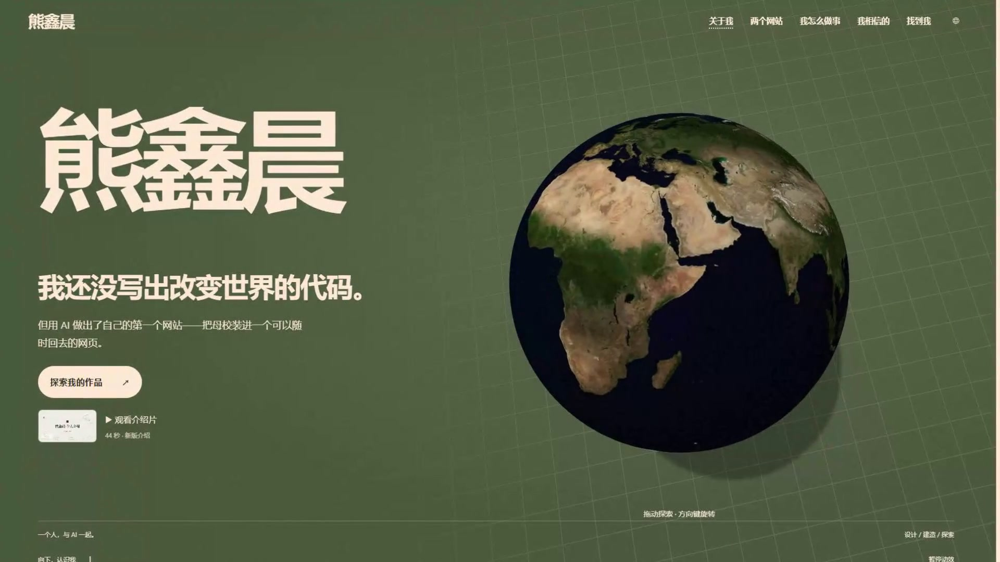
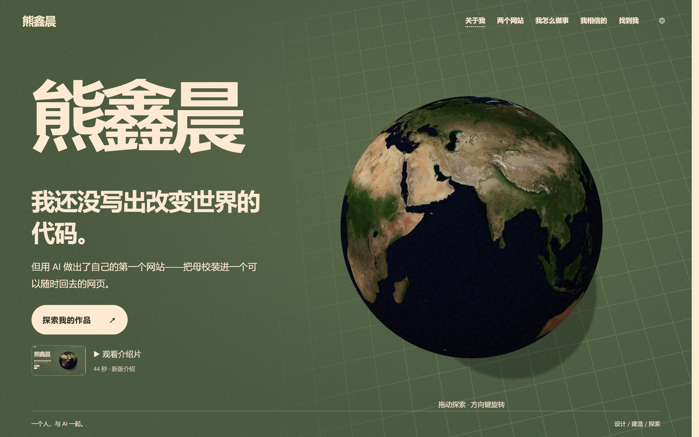
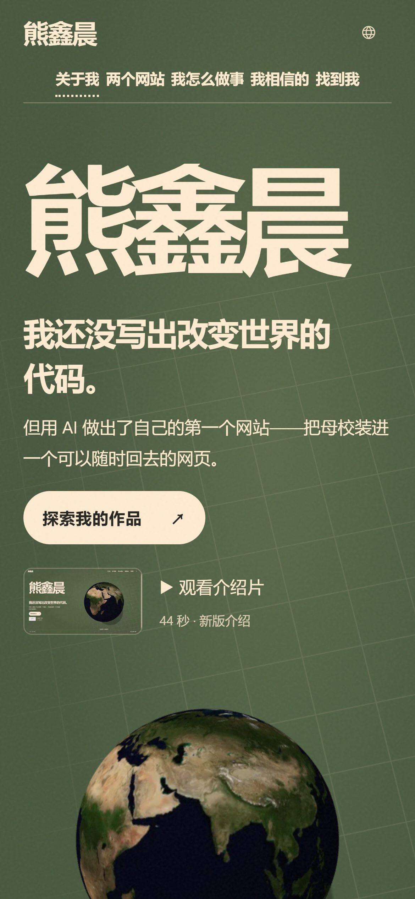

<sub><a href="README.md">简体中文</a> · <b>English</b></sub>

<div align="center">

# Xiong Xinchen · Personal website

*“I haven’t written code that changes the world yet.”*

[](https://xxc2007.me/)
[](#development)
[](LICENSE)

**One person, building with AI.**

A bilingual personal introduction, two live projects, a way of working, three beliefs and public contact links. Olive green, warm cream, large typography and a real Earth globe introduce the site; the projects supply the evidence.

</div>

## Watch the new film

A 44-second, 1920 × 1080 film made from the current website with Video Shotcraft. Real page captures, the live rotating Earth, gentle camera movement and an original soft score. No transition sound effects.

[](https://xxc2007.me/assets/video/)

[▶ Watch in the 1080p player](https://xxc2007.me/assets/video/) · [Download MP4](https://xxc2007.me/assets/video/intro-promo.mp4) · [No-music edition](https://xxc2007.me/assets/video/intro-promo-nobgm.mp4)

The film uses Chinese on-screen text. The English website remains fully translated.

## Current website




<p align="center"></p>

These are captures of the current local release candidate, refreshed on 16 October 2026. The desktop hero is a frame from its real browser recording; other captures come directly from Chrome. No UI has been redrawn for these previews.

## What is here

- **Earth hero:** locally hosted NASA Blue Marble imagery on a Three.js sphere. Drag, arrow-key rotation, reset and reduced-motion support. The main globe belongs to the hero; no orbit rings or movement into the About section.
- **Navigation:** desktop chapter links, current-section indicator, responsive menu and Chinese/English switch.
- **Two projects:** the Nanchang No. 15 memorial and GEOHOT, with project selection and a comparison of their purpose, content and implementation.
- **Working process:** four original steps, paired with an interactive visual sequence.
- **Beliefs and contact:** three original statements, email, social links and site sharing.
- **Film:** downloaded only after activation; a dedicated player, poster and direct download links.

| Project | Public site | Source |
|---|---|---|
| Nanchang No. 15 memorial | [Open](https://xxc2007.me/nc15/) | [Repository](https://github.com/xxc2007/In-memory-of-Nanchang-No.-15-Middle-School) |
| GEOHOT | [Open](https://xxc2007.me/geohot/) | [Repository](https://github.com/xxc2007/GeoHot) |

## Development

```sh
node tools/serve.mjs 8901
node scripts/check-parity.mjs
node scripts/check-links.mjs
node scripts/check-bytes.mjs
node --test "tests/*.test.mjs"
```

Open http://127.0.0.1:8901/. Static HTML, CSS and JavaScript; no application build step. The two language pages share styles and behavior. Three.js is self-hosted. Fonts retained for the supporting pages are also local. The main portfolio uses the system sans-serif stack.

## Measured source sizes

The values below are checked against the files by the quality suite. JS totals include the local Three.js modules; the later process scene is counted separately from initial JS. Images, Earth textures and video are not included in the JS total. These source measurements are not a Lighthouse score or a measurement of a visitor’s connection.

| Item | Current measurement | How to check |
|---|---|---|
| Repository files | **179** | `git ls-files \| wc -l` = 179 |
| HTML size | `24,111` / `24,542` B | index.html / en/index.html |
| Site CSS | **50.7 KB** (`51,962` B), gzip **11.5 KB** | assets/css/style.css |
| Hero JS | gzip **194.6 KB** | scripts/check-bytes.mjs |
| Images (avatar + two project shots) | **85.8 KB** (`87,886` B) | scripts/check-bytes.mjs |
| Social/share assets | **77.8 KB** (`79,646` B) | scripts/check-bytes.mjs |

## Publishing and verification

The existing deployment workflow pushes this repository to GitHub, publishes the tracked website files to the dedicated server directory and compares local files, GitHub blobs, server files and public responses. Deployment credentials stay in the ignored local configuration.

```sh
bash scripts/deploy.sh "feat: publish the redesigned portfolio and new film"
bash scripts/verify-sync.sh
```

The personal site owns `/` and `/en/`. `/nc15/`, `/geohot/` and the comment service have their own deployment boundaries. Updating this repository does not authorize replacing their content.

## Content and credits

Personal text, project descriptions and links follow [content sources](docs/content-sources.md). [ORYZO](https://oryzo.ai/) is the design reference; the site uses its own content and locally implemented visuals. Earth imagery: NASA Earth Observatory / Blue Marble Next Generation, August 2004, a cloud-free composite rather than live weather. Details: [image provenance](docs/image-provenance.md).

The new film uses real website captures and an original synthesized soft score. Production notes and validation: [film release](docs/promo-release-20261016.md). Code is [MIT](LICENSE); third-party assets retain their original terms.
