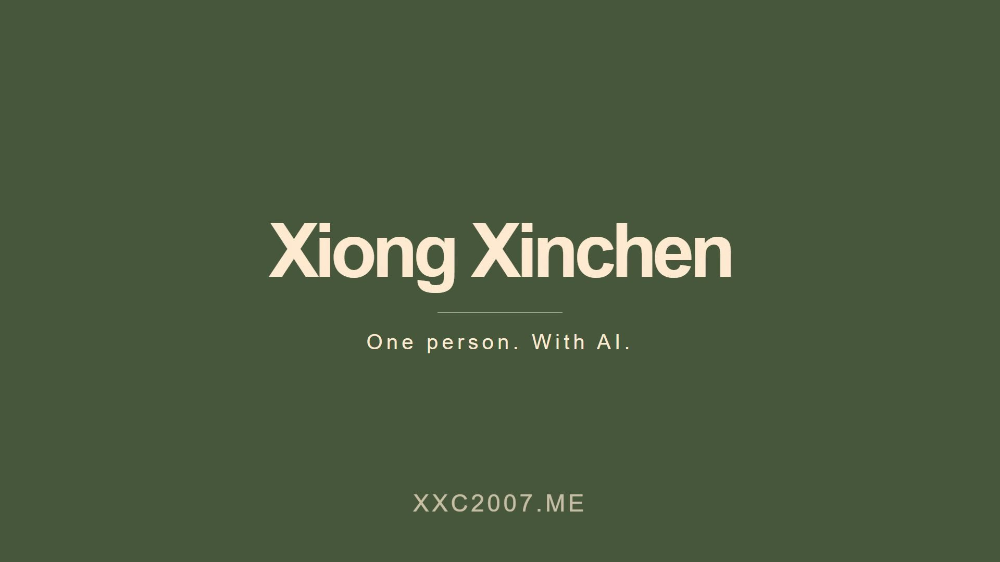
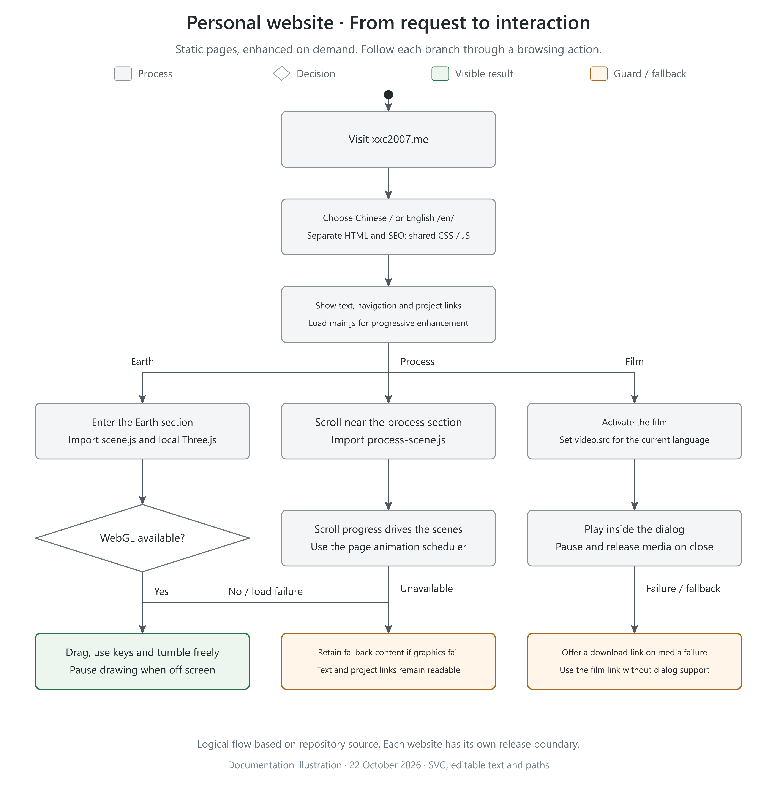

<sub><a href="README.md">简体中文</a> · <b>English</b></sub>

<div align="center">

# Xiong Xinchen · Personal Website

> *“I haven’t written code that changes the world yet.”*

[](https://xxc2007.me/en/)
[](https://xxc2007.me/)
[](#implementation)
[](LICENSE)

**Turn ideas into webpages. Let the work speak for the process.**

This is my personal introduction and the shared doorway to two live open-source projects—<br>
one preserving three years of high-school memory, the other reading a changing planet every morning in Chinese and English.<br>
Through its works, four-step craft, and quiet convictions, this zero-build bilingual site records how one person building with AI<br>
turns an idea into something people can visit, explore, and return to.

[Visit the site](https://xxc2007.me/en/) · [Watch the film](#product-film) · [Two Projects](#two-projects) · [Experience](#experience) · [Implementation](#implementation) · [Run Locally](#run-locally) · [Source Sizes](#measured-source-sizes) · [License](#license) · [Star History](#star-history)

</div>


## Product Film

Our new **68-second · 1080p 60fps** official launch film (available in both English and Chinese editions): carrying the site's exact olive, cream, forest, editorial-orange, and charcoal color-block rhythm from the Bezier opening and original NASA Blue Marble 3D Earth through the profile card, live English captures of both projects, the 4-step tilted 3D workflow, and the charcoal manifesto—scored to an original 116 BPM analog-synth soundtrack.

[](https://xxc2007.me/assets/video/en.html)

Play directly below:

https://github.com/user-attachments/assets/5dcdb916-12bd-47fe-98d7-1f608fd5e6a3

[▶ Watch in the 1080p player](https://xxc2007.me/assets/video/en.html) · [Open English MP4](https://xxc2007.me/assets/video/intro-promo-en.mp4) · [Chinese MP4](https://xxc2007.me/assets/video/intro-promo.mp4)

## Two Projects

**One keeps a place alive in memory; the other brings order to a noisy world.** Their subjects and stacks differ, yet both reflect the same hands-on practice in typography, vanilla frontend craft, cartography, and ongoing care.

| Project | Latest State & Engineering | Links |
|---|---|---|
| **Memorial by Qingshan Lake** | A tribute to Nanchang No. 15 Middle School built from 25 original campus photographs (served in AVIF), an eight-viewpoint photo tour, a multi-source campus map, and a login-free guestbook across ten static languages. | [Visit](https://xxc2007.me/nc15/en/) · [Source](https://github.com/xxc2007/In-memory-of-Nanchang-No.-15-Middle-School) |
| **GEOHOT · Geography in Focus** | Monitors 1,000 public geography sources through pre-filtering, dual scoring, and event grouping to publish daily editions—now with a **native English interface** (`/geohot/en/`), SSR, job queues, and open API / MCP endpoints. | [English](https://xxc2007.me/geohot/en/) · [中文](https://xxc2007.me/geohot/) · [Source](https://github.com/xxc2007/GeoHot) |


## Experience

- **An Earth you can turn by hand**: Self-hosted NASA Blue Marble imagery on a quaternion-driven 3D globe with unrestricted 360° tumbling, arrow-key controls, and view reset.
- **Always-visible chapter & language controls**: Plain text links stay expanded on desktop and mobile with an orange dotted active marker; the upgraded globe language menu works smoothly online and over `file://`.
- **A craft you can scroll through**: Four sticky chapters—*Purpose, Build, Mapping, Ship & Tend*—linked to tilted live previews.
- **Built for every visitor**: Full keyboard accessibility, static Earth fallback, `prefers-reduced-motion` support, and lazy-loaded media.

### Mobile Edition

<p align="center"></p>

## Implementation

| Layer | Engineering Choices |
|---|---|
| **Structure** | Pure static HTML with separate Chinese and English pages, full SEO metadata, shared styles/scripts, and **zero build step**. |
| **Style & Behavior** | Plain CSS handles color-block layout and states; vanilla JS drives scrollspy, project switching, language menu, and scroll choreography. |
| **3D Earth** | Self-hosted, tree-shaken Three.js and NASA textures with quaternion rotation and WebGL context-loss recovery. |
| **Quality Guardrails** | Automated bilingual parity, local link verification, byte budgets, and real-browser interaction regression tests. |

### How It Works

[](https://raw.githubusercontent.com/xxc2007/Introduction-of-XinChen-Xiong/main/docs/architecture/flow.en.186aa1efbee7.png)

<sub>Click for 3600 px PNG · [Editable SVG source](docs/architecture/flow.en.715898465b84.svg) · Sources: [main.js](assets/js/main.js) · [scene.js](assets/js/scene.js) · [process-scene.js](assets/js/process-scene.js).</sub>

## Run Locally

```sh
node tools/serve.mjs 8901       # open http://127.0.0.1:8901/en/
node scripts/check-parity.mjs   # bilingual parity check
node scripts/check-links.mjs    # local link verification
node scripts/check-bytes.mjs    # asset byte budgets
node --test "tests/*.test.mjs"  # unit & policy checks
```

## Measured Source Sizes

| Item | Current Measurement | Verification |
|---|---|---|
| Repository files | **238** | `git ls-files \| wc -l` = 238 |
| HTML size | `24,172` / `24,659` B | index.html / en/index.html |
| Site CSS | **52.5 KB** (`53,757` B), gzip **11.9 KB** | assets/css/style.css |
| Hero JS | gzip **146.3 KB** | scripts/check-bytes.mjs |
| Images (avatar + two project shots) | **112.5 KB** (`115,154` B) | scripts/check-bytes.mjs |
| Social/share assets | **77.8 KB** (`79,646` B) | scripts/check-bytes.mjs |

## Publishing, Credits & License

Deploy via `bash scripts/deploy.sh "<msg>"` and verify with `bash scripts/verify-sync.sh` (`/` and `/en/` stay cleanly isolated from `/nc15/` and `/geohot/`). Visual inspiration: [ORYZO](https://oryzo.ai/). Earth imagery: NASA Earth Observatory / Blue Marble Next Generation (see [content sources](docs/content-sources.md) & [image provenance](docs/image-provenance.md)).

## License

[MIT](LICENSE) © 2026 Xiong Xinchen (熊鑫晨). Third-party imagery retains its respective license.

## Star History

<p align="center">
  
</p>

---

<div align="center">
  <sub>One person, building with AI.<br>Ideas made into webpages · <a href="https://xxc2007.me/en/">xxc2007.me</a></sub>
</div>
