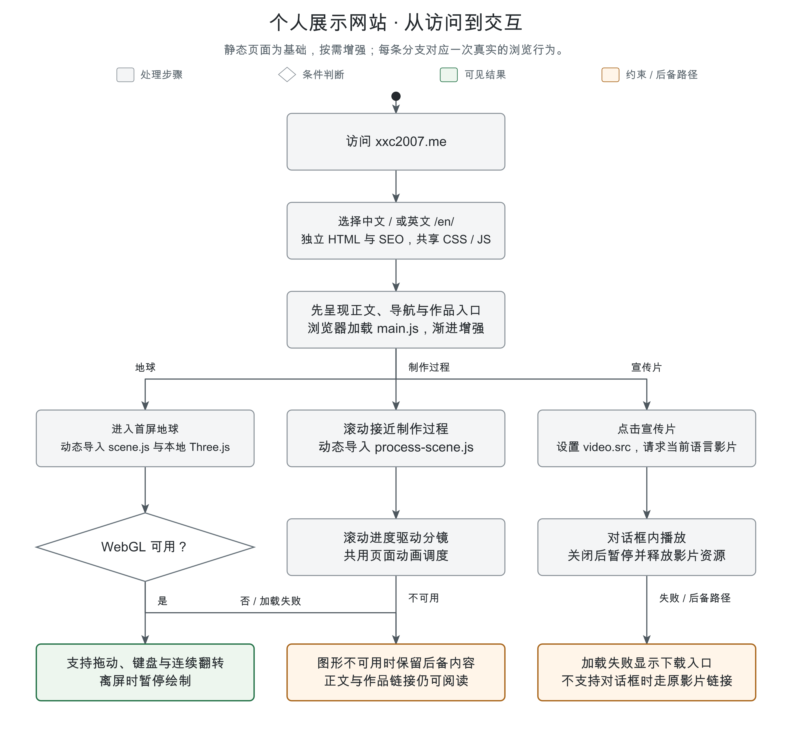

<sub><b>简体中文</b> · <a href="README.en.md">English</a></sub>

<div align="center">

# 熊鑫晨 · 个人展示网站

> *「我还没写出改变世界的代码。」*

[](https://xxc2007.me/)
[](https://xxc2007.me/en/)
[](#技术实现)
[](LICENSE)

**把想法做成网页，把过程留在作品里。**

这里是熊鑫晨的个人主页，也是两个已上线开源站点的共同门厅——<br>
一边是留存三年校园光阴的私人纪念册，一边是每日巡检千余信源的中英双语地理热点站。<br>
从个人简介、双站展厅、造站方法到心之所信，这座零构建的中英双语站点记录了一个人与 AI 协作，<br>
如何把最初的念头一步步打磨成可访问、可触摸、也愿意长期照料的网页。

[走进网站](https://xxc2007.me/) · [观看宣传片](#宣传片展示) · [两个作品](#两个作品) · [交互与体验](#交互与体验) · [技术实现](#技术实现) · [本地运行](#本地运行与质量检查) · [源码体积](#当前源码体积) · [License](#license) · [Star History](#star-history)

</div>


## 宣传片展示

全新 **68 秒 · 1080p 60fps** 官方宣传片（同步提供中文版与英文版）：完整延续官网的深橄榄绿、暖米白、深森林绿、活力橙与深炭黑五重色块节奏——从开场贝塞尔曲线与原版 NASA Blue Marble 3D 旋转地球启程，穿行于个人名片、双站真实截屏展厅、「构思 / 建造 / 地图 / 上线」四步 3D 透视联动与大字信念宣言，最后落版超大 `XXC2007` 字标。配以原创 116 BPM 温暖模拟合成器配乐与卡点音效。

点击下方播放器即可在本页观看：

https://github.com/user-attachments/assets/84a02c49-d0d7-48e9-80eb-6ba01b800be6

[▶ 打开 1080p 高清播放器](https://xxc2007.me/assets/video/) · [直接打开中文版 MP4](https://xxc2007.me/assets/video/intro-promo.mp4) · [英文版 MP4](https://xxc2007.me/assets/video/intro-promo-en.mp4)

## 两个作品

**一个安放记忆，一个整理世界。** 两个站点形态迥异、取舍不同，共同映照出我对版式、原生前端、地图表达与长期运维的实践。

| 作品 | 最新内容与工程取舍 | 线上与源码 |
|---|---|---|
| **青山湖畔的纪念册** | 以 25 张亲手拍摄的校园实景（支持 AVIF）、八机位时光漫游、多源中文定位图与免登录留言墙，纪念南昌市第十五中学。采用零框架原生前端与自托管留言服务，提供十种语言。 | [走进纪念册](https://xxc2007.me/nc15/) · [开源仓库](https://github.com/xxc2007/In-memory-of-Nanchang-No.-15-Middle-School) |
| **GEOHOT · 地理热点** | 持续巡检 1,000 个公开地理信源，经预筛、两次独立评分与事件归并，编成精选信息流与每日地理日报；现已上线**原生英文版**（`/geohot/en/`），支持 SSR、后台队列与 API / MCP 开放接口。 | [中文版](https://xxc2007.me/geohot/) · [English](https://xxc2007.me/geohot/en/) · [开源仓库](https://github.com/xxc2007/GeoHot) |


## 交互与体验

- **可以亲手拨动的蓝色星球**：以 NASA Blue Marble 无云卫星影像还原地表，四元数驱动 360° 无万向节锁自由拖拽，并支持键盘方向键翻转与一键回正。
- **始终在场的章节与双语导航**：桌面与移动端均直陈文字目录，当前阅读章节以橙色虚线标注；升级后的地球下拉语言菜单在公网与本地 `file://` 环境下均可顺畅切换。
- **可漫步的造站过程**：通过「构思 → 建造 → 地图 → 上线」四幕分镜与右侧透视预览联动，把幕后的设计取舍摊开在读者眼前。
- **照顾每一种访问方式**：兼顾键鼠与触屏，提供键盘无障碍操作、静态地球后备图与 `prefers-reduced-motion` 减弱动效；三维模块与宣传片均按需加载。

### 移动端页面

<p align="center"></p>

## 技术实现

| 层面 | 设计与工程取舍 |
|---|---|
| **页面结构** | 纯静态 HTML，中英文独立成页并配齐 SEO 元数据，共享样式与脚本，**零应用构建步骤**。 |
| **样式与交互** | 纯 CSS 承载色块节奏与响应式状态；原生 JavaScript 驱动章节识别、作品切换、地球语言菜单与滚动联动。 |
| **三维地球** | 本地托管 Tree-shaken Three.js 与 NASA 地球贴图，四元数组合旋转实现连续翻转，妥善处理 WebGL 上下文丢失与恢复。 |
| **质量守卫** | 内置中英文结构对拍、死链扫描、体积预算与静态规则检查，配合真实浏览器交互回归测试。 |

### 底层原理与运行流程

[](https://raw.githubusercontent.com/xxc2007/Introduction-of-XinChen-Xiong/main/docs/architecture/flow.zh.b6c1441ea322.png)

<sub>点击打开 3600px 高清原图 · [可编辑 SVG 源文件](docs/architecture/flow.zh.fe4a447f42e4.svg) · 实现依据：[main.js](assets/js/main.js) · [scene.js](assets/js/scene.js) · [process-scene.js](assets/js/process-scene.js)。</sub>

## 本地运行与质量检查

```sh
node tools/serve.mjs 8901       # 打开 http://127.0.0.1:8901/（英文版 /en/）
node scripts/check-parity.mjs   # 中英文结构对拍
node scripts/check-links.mjs    # 本地链接检查
node scripts/check-bytes.mjs    # 资源体积预算核验
node --test "tests/*.test.mjs"  # 静态与策略测试
```

## 当前源码体积

| 项目 | 当前测量 | 复算方式 |
|---|---|---|
| 仓库文件 | **238** | `git ls-files \| wc -l` = 238 |
| 中英两页字节 | `24,181` / `24,710` B | index.html / en/index.html |
| 全站 CSS | **52.5 KB** (`53,757` B), gzip **11.9 KB** | assets/css/style.css |
| 首屏 JS（含 Three.js） | gzip **146.3 KB** | scripts/check-bytes.mjs |
| 图片（头像 + 两张作品截图） | **112.5 KB** (`115,154` B) | scripts/check-bytes.mjs |
| 不进首屏的分享素材 | **77.8 KB** (`79,646` B) | scripts/check-bytes.mjs |

## 发布、署名与开源许可

发布流程：`bash scripts/deploy.sh "<msg>"` 随后 `bash scripts/verify-sync.sh`（本仓库仅负责 `/` 与 `/en/`，与 `/nc15/`、`/geohot/` 保持独立发布边界）。设计参考 [ORYZO](https://oryzo.ai/)，地球影像来自 NASA Earth Observatory / Blue Marble Next Generation（详见[内容出处](docs/content-sources.md)与[图像出处](docs/image-provenance.md)）。

## License

[MIT](LICENSE) © 2026 熊鑫晨（Xiong Xinchen）· 第三方素材遵循各自许可协议。

## Star History

<p align="center">
  
</p>

---

<div align="center">
  <sub>一个人，与 AI 一起。<br>把想法做成网页 · <a href="https://xxc2007.me/">xxc2007.me</a></sub>
</div>
